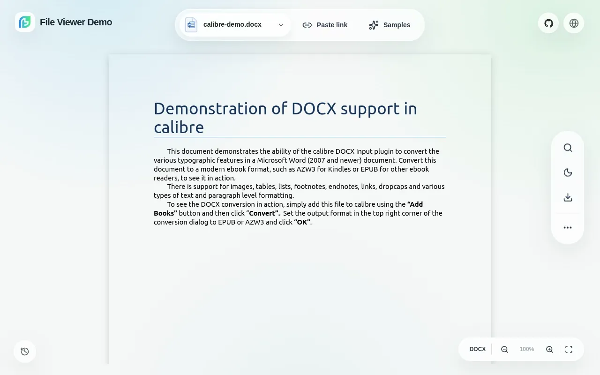

<p align="center">
  <a href="https://file-viewer.app/en/"></a>
</p>
<h1 align="center">File Viewer</h1>

<p align="center">
  File Viewer provides read-only previews for Office, PDF/OFD, CAD, archives, email and more, in the browser.<br>
  Built-in renderers need no conversion server; Workers, WASM and fonts can be self-hosted.
</p>
<p align="center">
  <strong>English</strong> · <a href="README.zh-CN.md">简体中文</a>
</p>
<p align="center">
  <a href="https://demo.file-viewer.app/">Live demo</a> ·
  <a href="https://doc.file-viewer.app/">Documentation</a> ·
  <a href="https://doc.file-viewer.app/guide/formats">Format matrix</a> ·
  <a href="https://github.com/flyfish-dev/file-viewer/releases">Releases</a>
</p>
<p align="center">
  <a href="https://www.npmjs.com/package/@file-viewer/core"></a>
  <a href="https://github.com/flyfish-dev/file-viewer/releases"></a>
  <a href="https://github.com/flyfish-dev/file-viewer/actions/workflows/public-ci.yml"></a>
  <a href="LICENSE"></a>
</p>
<p align="center">
  <a href="https://www.npmjs.com/package/@file-viewer/core"></a>
  <a href="https://github.com/flyfish-dev/file-viewer/stargazers"></a>
  <a href="https://hub.docker.com/r/flyfishdev/file-viewer"></a>
  <a href="https://github.com/sponsors/wybaby168"></a>
</p>
<p align="center">
  <a href="https://demo.file-viewer.app/"></a>
</p>
<p align="center">⭐ If File Viewer helps you, please <a href="https://github.com/flyfish-dev/file-viewer">star the repo</a>.</p>

The current source prepares a `3.3.0` release candidate with the published DOCX `0.3.39` engine. File Viewer packages and production sites have not been released from this candidate. See [the candidate notes](CHANGELOG.md).

## Why File Viewer

- **275 registered extensions** (225 stable, 50 experimental) across 47 preview pipelines: Word, Excel, PowerPoint, PDF, OFD, DWG/DXF, STEP/IFC, archives, email, images, media, code, DICOM and more.
- **No conversion server.** Files are parsed and rendered in the browser; Workers, WASM and fonts can be self-hosted for offline networks.
- **Loads only what a file needs.** Heavy engines (PDF, CAD, Office, 3D) are lazy-loaded per format.
- **One API, every framework.** Web Component, Vue 3, Vue 2.7/2.6, React 16.8–19, Svelte and jQuery share options, events and controller methods.

## Quick start

The Web Component works without a framework:

```bash
npm install @file-viewer/web-full
```

```js
import { mountViewer } from '@file-viewer/web-full'

mountViewer(document.querySelector('#viewer'), {
  url: '/documents/handbook.pdf',
  filename: 'handbook.pdf'
})
```

Give `#viewer` a height. The URL must be reachable by the browser; cross-origin files need the appropriate CORS headers. You can also pass a `File` instead of a URL.

For a new project, `npm create file-viewer@latest my-viewer` sets up a runnable example. To add File Viewer to an existing project, use `npx file-viewer-cli@latest add .`. The [CLI guide](https://doc.file-viewer.app/guide/cli) describes the packages and assets each choice installs.

| Application | Light component | Full compatibility package | Guide |
| --- | --- | --- | --- |
| Vanilla JS / Web Component | `@file-viewer/web` | `@file-viewer/web-full` | [Web](https://doc.file-viewer.app/guide/quickstart-web) |
| Vue 3 | `@file-viewer/vue3` | `@file-viewer/vue3-full` | [Vue 3](https://doc.file-viewer.app/guide/quickstart-vue3) |
| Vue 2.7 / 2.6 | `@file-viewer/vue2.7` / `@file-viewer/vue2.6` | matching `-full` package | [Vue 2](https://doc.file-viewer.app/guide/quickstart-vue2) |
| React 18 / 19 | `@file-viewer/react` | `@file-viewer/react-full` | [React](https://doc.file-viewer.app/guide/quickstart-react) |
| React 16.8 / 17 | `@file-viewer/react-legacy` | `@file-viewer/react-legacy-full` | [React Legacy](https://doc.file-viewer.app/guide/ecosystem#react-legacy) |
| Svelte | `@file-viewer/svelte` | `@file-viewer/svelte-full` | [Svelte](https://doc.file-viewer.app/guide/quickstart-svelte) |
| jQuery | `@file-viewer/jquery` | `@file-viewer/jquery-full` | [jQuery](https://doc.file-viewer.app/guide/ecosystem#jquery) |

For formats beyond a light component's built-in baseline, add a preset or individual renderers. For example:

```ts
import officePreset from '@file-viewer/preset-office'
import { FileViewer } from '@file-viewer/vue3'

const options = { preset: officePreset }
```

`options.preset` also accepts an array. See [presets and renderers](https://doc.file-viewer.app/guide/on-demand-renderers) for the available combinations.

## Formats and limits

The [format matrix](https://doc.file-viewer.app/guide/formats) lists extensions, renderer packages, support levels and evidence. It covers common documents and media as well as specialist formats such as engineering drawings, 3D models and design files. An extension in the matrix does not mean every file of that type has identical fidelity.

The eight `*-full` packages preserve the published v2.4 `preset-all` compatibility baseline: 221 extensions across 32 preview pipelines. New specialist renderers, including Adobe design files, DICOM and binary inspection, are installed explicitly; they are not silently added to existing Full packages. For a smaller installation, choose a light component with `@file-viewer/preset-lite`, `@file-viewer/preset-office`, `@file-viewer/preset-engineering` or individual renderers.

File Viewer is a viewer, not an editor. Fonts, vendor-specific features, encrypted files and very large inputs can affect fidelity or memory use. Check the format matrix before relying on a specialist format in production, and test with representative files from your own workflow.

Opt-in [BPMN diagrams](docs/guide/bpmn.md) (`@file-viewer/renderer-drawing/bpmn`) and [XML validation/transformation profiles](docs/guide/xml-profiles.md) (`@file-viewer/renderer-text/xml-profiles`) ship on npm since 3.1.2; they are not added to Full packages.

## Runtime assets

Full packages include version-matched Workers, WASM, fonts and vendor assets, but those files must be served alongside your application. The default asset path is `<deployment-base>/file-viewer/`.

| Build or delivery | Asset step |
| --- | --- |
| Vite | Install `@file-viewer/vite-plugin` and configure `fileViewerRenderers({ copyAssets: true })`. |
| Webpack, Rspack, Rollup, Vue CLI or Umi | Run `npx --no-install file-viewer-copy-assets ./public/file-viewer` with the matching Full package installed. |
| Web Full IIFE / CDN | Serve the complete package `dist/` directory, not only the entry JavaScript file. |

For nonstandard paths and offline deployments, see the [asset and distribution guide](https://doc.file-viewer.app/guide/distribution). A missing Worker or WASM file can leave a format unavailable even when its JavaScript package is installed.

<!-- FILE_VIEWER_PUBLIC_GENERATED:START -->

## Work from source

This repository contains the public source for the core, renderers, presets, components, CLI, demo and documentation. Released archives and npm tarballs are available from [GitHub Releases](https://github.com/flyfish-dev/file-viewer/releases), rather than tracked in Git.

```bash
pnpm install --frozen-lockfile
pnpm type-check
pnpm test
pnpm build
pnpm docs:build
pnpm verify:browser-smoke
```

<!-- FILE_VIEWER_PUBLIC_GENERATED:END -->

## Contributing and support

If a documented format fails, please include a sanitized sample or a public reproduction link, the browser version and the expected result. A screenshot alone rarely identifies a parser or rendering bug. Read [CONTRIBUTING.md](CONTRIBUTING.md) before opening a pull request; report security issues through [SECURITY.md](SECURITY.md).

New contributors: [local development](docs/guide/development.md), [international collaboration](docs/guide/collaboration.md), and [translations](docs/guide/translations.md). English and Chinese are welcome; other languages can include a short English summary.

Maintenance is supported through [GitHub Sponsors](https://github.com/sponsors/wybaby168). For private deployment or work requiring a response commitment, see [enterprise support](https://dev.flyfish.group/shop).

### Thanks to Our Sponsors

<p align="center">
  
  <br>
  <sub><a href="https://github.com/p4535992">@p4535992</a> · <a href="https://github.com/jtianling">@jtianling</a></sub>
</p>

## Star History

<a href="https://www.star-history.com/?type=date&repos=flyfish-dev%2Ffile-viewer">
 <picture>
   <source media="(prefers-color-scheme: dark)" srcset="https://api.star-history.com/chart?repos=flyfish-dev/file-viewer&type=date&theme=dark&legend=top-left" />
   <source media="(prefers-color-scheme: light)" srcset="https://api.star-history.com/chart?repos=flyfish-dev/file-viewer&type=date&legend=top-left" />
   
 </picture>
</a>

## License

File Viewer's own source is Apache-2.0. The DWG/DWF/DWFX runtime (`@flyfish-dev/cad-viewer` and `dwf-viewer`) is **AGPL-3.0-only**; using or distributing CAD support requires complying with that license. See [LICENSE](LICENSE) and the runtime package notices.

## PDF URL loading

Standard component PDF URLs stream on the same origin by default. Use `pdf.streaming: true` plus an explicit filename/type for CORS-enabled signed URLs, or `false` to buffer once. For demanded Range reads set both `pdf.disableStream` and `pdf.disableAutoFetch` to `true`; server Range/CORS support is required. Explicit bytes and caller-owned fetch hooks retain precedence.
