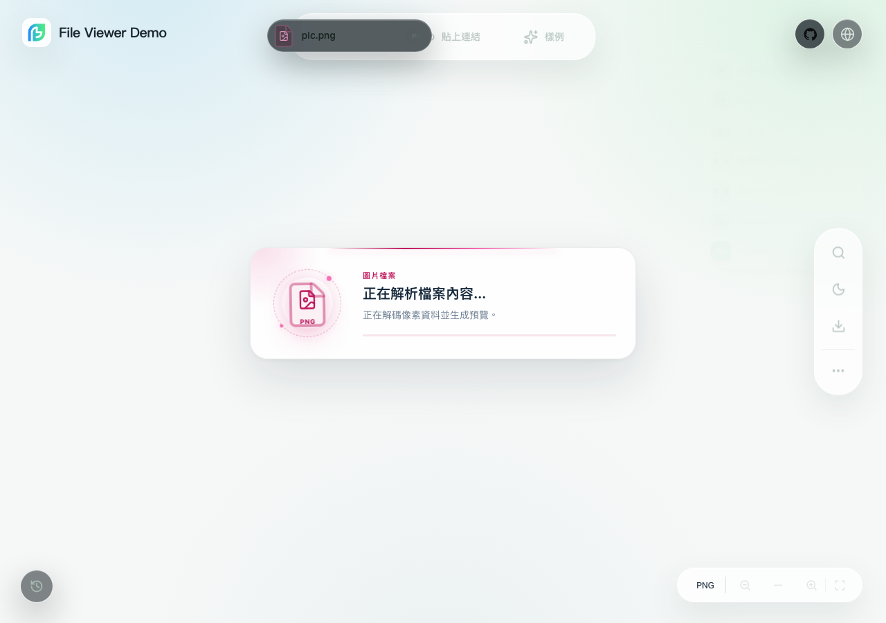
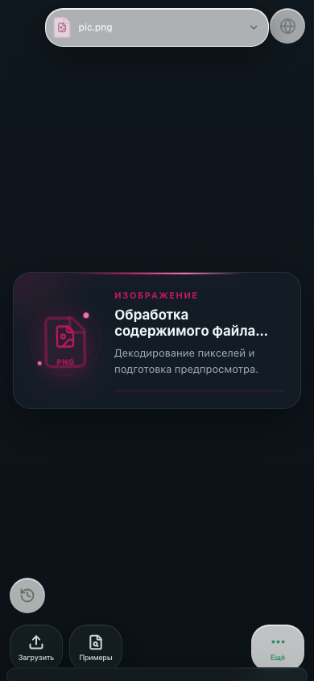

# Interface translation review

The registry at `packages/core/src/i18n/locales.ts` defines bundled UI languages. Base copy lives in `packages/core/src/i18n/messages.*.ts`; feature resources live in `packages/core/src/i18n/domains/`. Demo copy is maintained separately from component messages.

| Language | Terminology focus | Independent native review |
| --- | --- | --- |
| `zh-CN` | Preview, extraction, conversion and licensing distinctions | Pending for this change |
| `en-US` | Concise UI grammar, count forms, diagnostic meaning | Pending for this change |
| `ja-JP` | Natural control labels and technical terminology | Pending for this change |
| `zh-TW` | 軟體、網路、檔案、載入、搜尋、字型、匯出 | Pending |
| `zh-HK` | 軟件、網絡、檔案、載入、搜尋、匯出 | Pending |
| `de-DE` | Compound nouns, longer labels, singular/plural forms | Pending for this change |
| `ru-RU` | Grammatical cases and one/few/many/other forms | Pending |

Traditional Chinese conversion supplied an initial draft only. Taiwan and Hong Kong resources are separate static dictionaries with regional terminology edits. No runtime conversion library or network translation service is used. Technical validation is not native-speaker sign-off.

Review visible copy, titles, placeholders, ARIA names, dynamic announcements, password and installation prompts. Keep signature validity, partial/structure-only support, watermarks and licensing equivalent. Preserve interpolation names, raw diagnostics and document content. Each future language must pass registry-derived resource and framework checks; there is no fixed message-count gate.

Browser-managed dialogs and media controls follow browser/OS settings. Raw metadata, binary format identifiers, authored names and upstream parser diagnostics may intentionally retain their original text. These are distinct from viewer controls.

## Visual checks

These screenshots capture translated image-loading feedback in the built Demo, using the repository's `pic.png` sample. They were recorded against implementation commit `c3cc89d768d481acc564a9ea9b5193f3c47d68c7` in Chromium 156.0.8078.4. They illustrate UI copy and layout; they do not establish native-speaker approval or release qualification.

