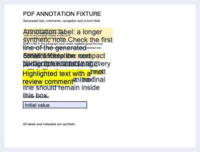
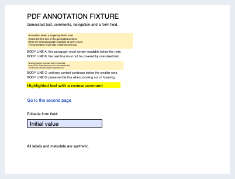

# PDF annotation regression

`annotations.pdf` is generated entirely by `generate.mjs` using pdf-lib. Its
content and metadata are synthetic, its dates are fixed, and it reads no input
files or external resources. It is distributed under the repository license.

The first page contains two FreeText annotations with four and three authored
lines, ordinary body text directly below them, a highlight with a five-paragraph
comment and an explicitly closed popup, an editable text field, and a link to
the second page. One FreeText annotation is read-only. Oversized HTML duplicates
overlap the nearby body lines before the fix; the authored appearances fit
inside their boxes after the fix.

Regenerate the committed PDF:

```sh
node packages/renderers/pdf/test/fixtures/annotations/generate.mjs
```

Build the renderer and run the regression:

```sh
pnpm --filter @file-viewer/core build
pnpm --filter @file-viewer/renderer-pdf build
pnpm --filter @file-viewer/renderer-pdf verify:annotations
```

The test checks the committed bytes against the generator, then runs real local
PDF Workers in Chromium and WebKit, in ordinary DOM and an open Shadow DOM, at
40%, 100% and 200% zoom. It verifies invisible HTML annotation text, complete
multiline extraction, and authored appearance/geometry. Both glyph-bearing
appearance regions are compared against a native PDF.js canvas render. Popup
checks cover hover/hide, click pin/unpin, complete comment text, scaled text,
wrapping and text containment in both dimensions. Editable fields, internal
links and teardown remain covered.
No remote resources are required. Reports and screenshots go to
`output/pdf-annotations/` (or `PDF_ANNOTATIONS_OUTPUT`).

These matched first-page crops use the generated PDF at 40% zoom and a 1100 x 880
viewport. The before image uses the annotation styles from base revision
`d6bcb1a9` in an isolated browser harness; the after image uses the fixed
renderer. They illustrate the regression and are not portable pixel goldens.

| Before | After |
| --- | --- |
|  |  |
