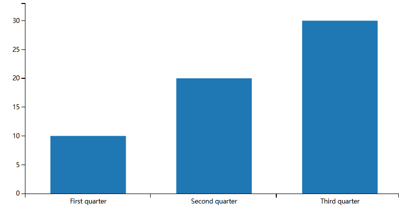
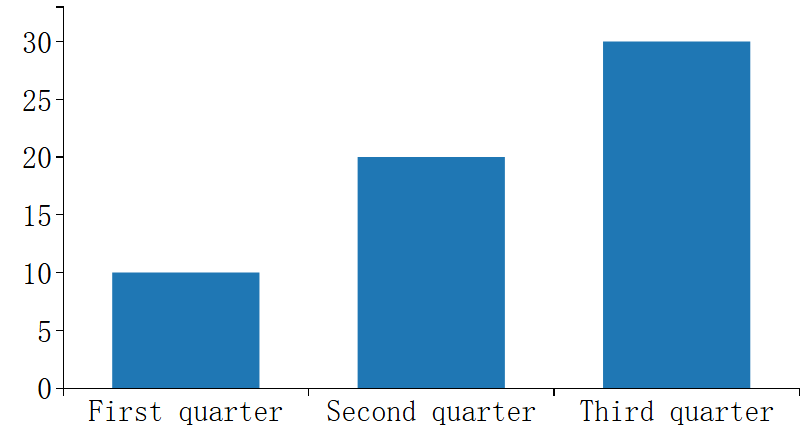

# PPTX chart fonts and local axis layout

This original synthetic reproduction contains three values (10, 20, 30), English
quarter labels and an authored 18 pt generic serif font. It does not contain an
input document, external fonts, customer data or downstream application code.
It uses the serializable `PptxChartModel` format already consumed by the public
renderer. The repository's Apache-2.0 license applies.

Run from the repository root after the documented dependency installation:

```sh
pnpm exec playwright install chromium
node packages/renderers/pptx/scripts/verify-chart-axis-layout.mjs
```

`PLAYWRIGHT_CHROMIUM_EXECUTABLE_PATH` can select an existing Chromium binary.
`PPTX_CHART_OUTPUT` can select the evidence directory; its default is the ignored
`output/pptx-chart-axis-layout` directory. The script requires the baseline commit
`7e5e131c5340dbd421e47725c895554ecc75ff11` in the local Git history. It reads only
the two affected renderer source files from that commit for the before run.

The same chart is generated at slide scale 0.35, then detached and reattached at
1.25 and 0.5. It checks authored fonts and axis-label containment in logical chart
coordinates. A separate patched case initializes while hidden, then displays and
flushes. Destruction must remove the chart surface and owned font style. HTTP
requests and uncaught browser errors fail the reproduction.

The screenshots below show the matched 1.25-scale reparenting phase. They were
generated with Chromium 153.0.8010.12 at device scale factor 1. Before: 25 font or
clipping failures across 30 label observations. After: zero; hidden initialization:
10 labels, zero failures. They document this synthetic scene, not a full renderer
or browser compatibility matrix.
Explicit min/max endpoint padding remains unchanged; this fixture uses the normal
automatic value range to isolate font persistence and local axis measurement.

| Baseline | Patched |
| --- | --- |
|  |  |
